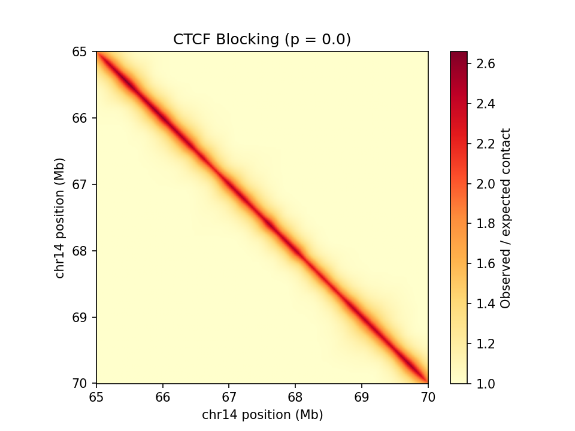
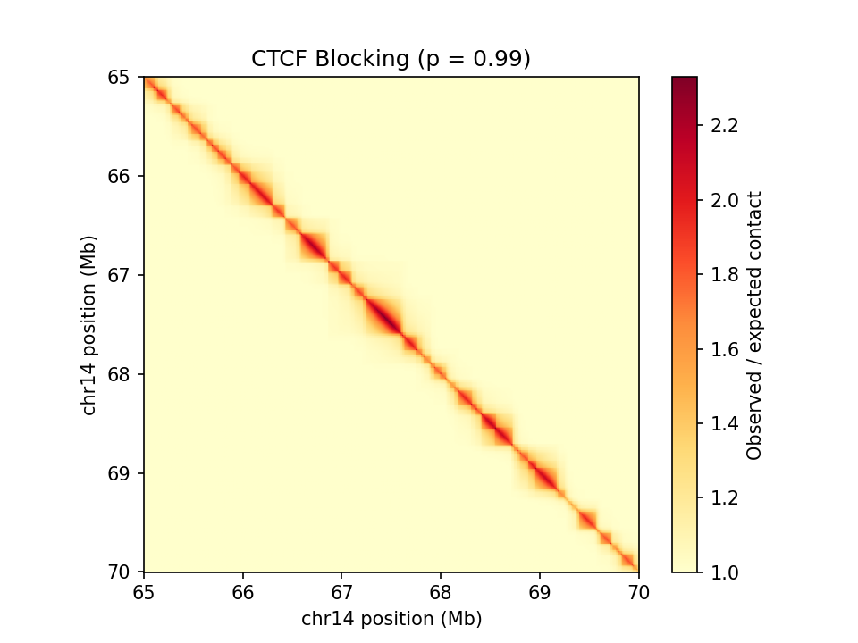
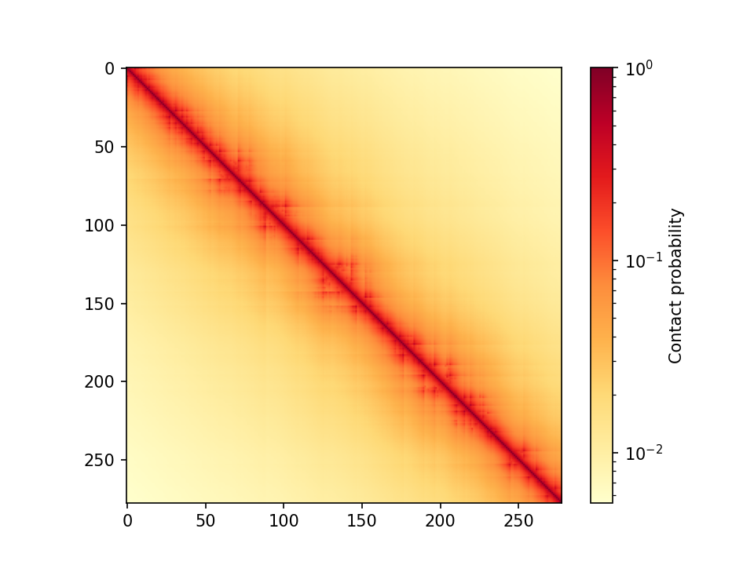
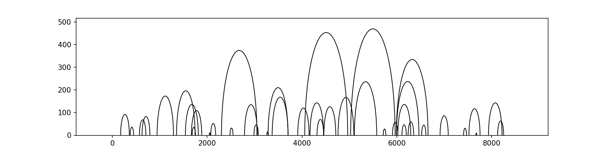
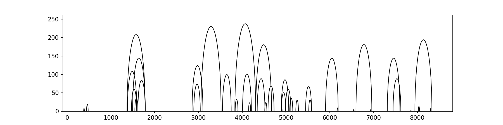

# Simulation of Chromosomal Domain Formation by Loop Extrusion

02-601 Programming for Scientists, Fall Semester
Team: Anastasiia Streltsova, Ryan Quach, Grace Gupta

## Goal

We simulate 1D cohesin loop extrusion on human chr14 (65–70 Mb),
following Fudenberg et al. 2016, "Formation of Chromosomal Domains
by Loop Extrusion". CTCF sites act as barriers that block cohesin.
From the simulated loops we build contact maps and compare them
with Hi-C data from Rao et al. 2014 (GM12878).

## How to run

Requirements: Python 3.13.2, numpy, matplotlib, hicstraw, pytest

    pip install numpy matplotlib hicstraw pytest

Data files needed in the repo folder:
- `ctcf_whole_genome.bed` — CTCF ChIP-seq peaks (<source>)
- `GSE63525_GM12878_primary+replicate_HiCCUPS_looplist.txt.gz` —
  Rao 2014 loop list (GEO GSE63525)

Run:

    python loop.py       # simulation + loop-based contact map
    python sh_loop.py    # simulation + shortest-path contact map
    pytest               # tests

## Files

| File | Contents |
|---|---|
| `dataclass.py` | `Cohesin`, `Sequence`, `ContactMap` classes |
| `loop.py` | Main simulation loop; contact map built from loop positions |
| `sh_loop.py` | Contact map built from shortest-path distances |
| `parsers.py` | Reads the CTCF bed file; converts peaks to lattice positions |
| `hic_compare.py` | Loads Rao Hi-C data; finds simulated loops; compares them with Rao loops |
| `visualization.py` | Arc plots and contact-map plots |
| `test_cohesin.py` | Unit tests for cohesin movement and CTCF blocking |

## Model

- 1 site = 600 bp
- 40 cohesins (about 125 kb apart, close to the paper's 120 kb)
- Each step, an unbound cohesin binds at a random free site.
  A bound cohesin moves each leg one site outward.
- At a CTCF site, a leg is blocked with probability `prob_block`
  (default 1.0)
- Each step, a cohesin unbinds with probability 0.007
- Snapshots are taken every 10 steps. The second half is used
  for averaging.

## Contact maps

We have two approaches:

1. **Loop-based (`loop.py`)**: baseline contact ∝ 1/(1+d). Pairs
   inside a loop get a multiplier.
2. **Shortest-path (`sh_loop.py`)**: each loop is treated as a
   shortcut along the chromosome. Contact ∝ (shortest distance + 1)^-α,
   averaged over snapshots.

## Current results

All results: chr14 65–70 Mb, 40 cohesins, 1 site = 600 bp.
Maps average the second half of the snapshots.

### Loop-based contact maps (`loop.py`)

**No CTCF blocking (p = 0.0).** Observed/expected contact map,
12 kb per bin. Cohesins load and extrude anywhere, so loops are
spread evenly along the region. The result is a uniform band
along the diagonal with no domain structure.

**CTCF blocking (p = 0.99).** Same map, but cohesin legs stop at
CTCF sites. Square domains appear along the diagonal. Each square
is a region between neighboring CTCF sites where loops build up.
Domains vary in size. This is the TAD-like pattern the paper
predicts.

### Shortest-path contact map (`sh_loop.py`)

**Shortest-path model (CTCF blocking p = 1.0).** Contact
probability on a log scale; axes are bin indices (18 kb per bin).
Loops shorten the path along the chromosome, which raises contact
between distant regions. Small domains and dots near the diagonal
come from loops stopped at CTCF sites. Contact falls off with
distance, but that falloff is partly set by the model's power law.

### Loops in the final snapshot

**No CTCF blocking (p = 0.0).** Each arc is one cohesin loop in
the last snapshot. The x-axis is lattice position (600 bp per
site). Arc width equals loop size. Loops are scattered, vary in
size, and some cross each other, because cohesins don't collide
in our model yet.

**CTCF blocking (p = 0.99).** Loops now group into clusters with
gaps in between. Within a cluster, nested loops often share an
end point at the same CTCF site. This is how the domains in the
contact map form.

## Known limitations / planned work

- Cohesins can pass through each other. In the paper, they stay put
  when they collide.
- CTCF orientation is ignored (the bed file has no strand
  information).
- Both contact models impose a power law by hand. Potentially planned:
  a Gaussian-chain polymer model.
- Planned: P(s) curves (contact probability vs distance) compared
  with Rao Hi-C.

## Questions for feedback

1. Is it enough to keep our two approaches, or is it worth also
   trying a Gaussian-chain polymer model?
2. Should the final presentation compare both contact-map approaches,
   or pick one?
3. Should we add P(s) curves to compare with the data?

## AI use

Test functions entirely Claude. Other functions: Claude assistance. Dataclass.py and base loop function had no assistance.
